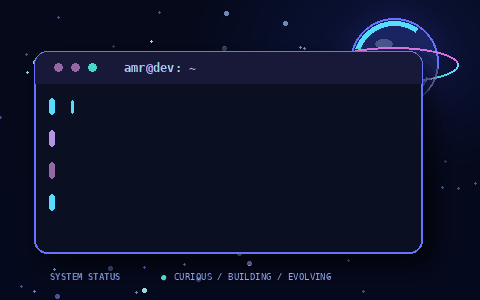

<!--
  AMR FATHI — GITHUB PROFILE README
  Theme: Cosmic midnight / neon cyan / violet
  Repository: Amro-Fathi/Amro-Fathi
-->

 

---

## 👨‍💻 The Developer Behind the Code

  

Hey! I'm **Amr Fathi**, a software developer interested in the creative and technical sides of building software. I enjoy crafting thoughtful interfaces, exploring programming languages, and understanding the logic and systems behind applications.

For me, development is more than making something work. It's about understanding the problem, choosing a sensible approach, writing clear code, and finding ways to improve the result.

- 💻 Interested in full-stack development and modern web technologies.
- 🎨 Passionate about creative UI/UX, responsive layouts, and detailed CSS work.
- ⚡ Exploring JavaScript, TypeScript, APIs, and application logic.
- 🧠 Interested in programming fundamentals, data structures, and problem-solving.
- 🔬 Enjoy experimenting, debugging, and understanding why solutions work.
- 🌱 Always learning and refining my engineering mindset.

---

## 🧰 My Technical Toolkit

I use technologies as tools for solving problems, and I’m interested in understanding their underlying concepts rather than collecting names on a list.

### 🎨 Frontend Development

  
    
  
  
  

My frontend interests include semantic HTML, responsive layouts, CSS animations and transitions, pseudo-elements, custom shapes, Sass mixins and variables, DOM manipulation, event handling, browser storage, and building maintainable interface components.

### ⚙️ Backend Development & Data

  
    
  
  
  

I'm interested in backend logic, SQL and relational database fundamentals, HTTP requests, API consumption, JSON structures, filtering, pagination, efficient data retrieval, and how information flows between application layers.

### 💻 Programming Languages

  

I value transferable programming fundamentals: control flow, functions, data structures, algorithms, pointers and memory concepts, object-oriented programming, and learning how different languages behave.

### 🔧 Tools & Workflow

  

My workflow focuses on version control, debugging, browser developer tools, repository organization, readable code, and maintainable project structure.

---

## 📊 A Window Into My Developer Journey

  <table>
    <tr>
      <td width="50%" align="center" valign="middle">
        
      </td>
      <td width="50%" align="center" valign="middle">
        
      </td>
    </tr>
  </table>
   
  

### 🌌 Contribution Galaxy

  

### 🐍 Contribution Snake

  <picture>
    <source media="(prefers-color-scheme: dark)" srcset="https://raw.githubusercontent.com/Amro-Fathi/Amro-Fathi/output/github-contribution-grid-snake-dark.svg" />
    <source media="(prefers-color-scheme: light)" srcset="https://raw.githubusercontent.com/Amro-Fathi/Amro-Fathi/output/github-contribution-grid-snake.svg" />
    
  </picture>

---

## 🧠 How I Approach Development

<table>
  <tr>
    <td align="center" width="50%">
      <h3>🔍 Understand</h3>
      Learn why something works instead of memorizing a solution.
    </td>
    <td align="center" width="50%">
      <h3>🧩 Solve</h3>
      Break complicated problems into smaller, manageable steps.
    </td>
  </tr>
  <tr>
    <td align="center" width="50%">
      <h3>🎨 Create</h3>
      Combine functionality with thoughtful design and intuitive interactions.
    </td>
    <td align="center" width="50%">
      <h3>⚡ Improve</h3>
      Refine code for readability, performance, and maintainability.
    </td>
  </tr>
</table>

I care about code quality, first-principles thinking, design detail, curiosity, and consistent progress. I’d rather understand a concept deeply than use a tool blindly.

---

## 🌱 What I'm Growing Into

  
   
  
   
  
   
  
   
  

I'm continuing to strengthen my understanding of language behavior, asynchronous programming, algorithms, data structures, backend architecture, databases, API design, performance, and the trade-offs behind engineering decisions.

---

Designed with curiosity, powered by coffee, and driven by the next thing to learn. ☕

<!--
NOTES:
- Upload assets/cosmic-terminal.gif along with this README.
- The contribution snake is generated by .github/workflows/snake.yml.
- Enable read/write workflow permissions in Settings > Actions > General.
- Third-party stat and icon services may occasionally be unavailable or rate-limited.
-->
